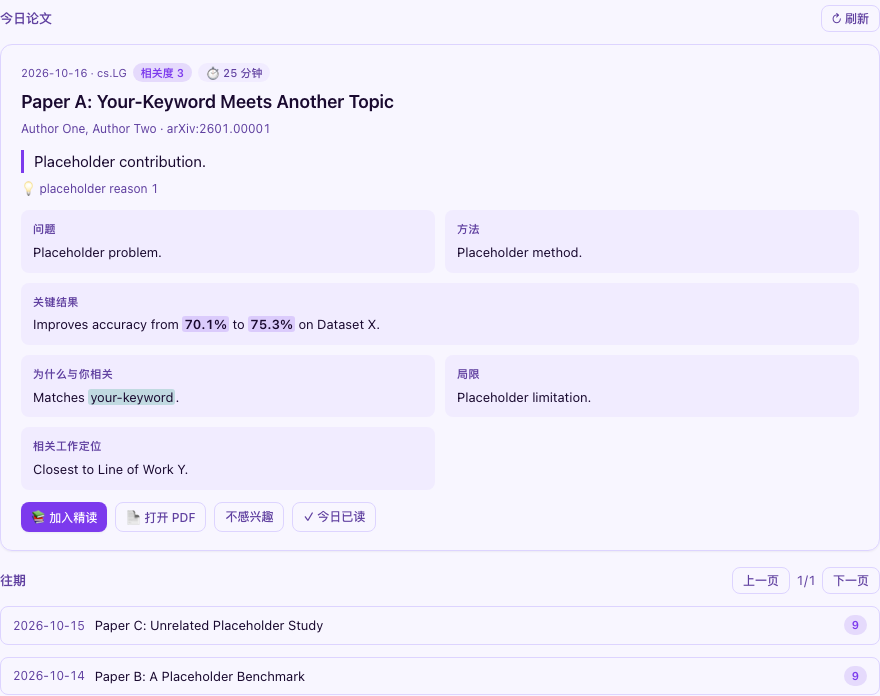

# 📬 文献日推

每天只推 **1 篇** 最新且最相关的 arXiv 论文，并给出"一眼能读完"的结构化摘要。
抓取和打分在 **你自己 fork 的 GitHub Actions** 里运行，工作台只负责展示和「加入精读」，不经过任何第三方服务器。

入口：「📖 文献 & 投稿」→「📬 日推」。

## 快速开始

1. Fork 模板仓库 [daily-paper-template](https://github.com/nikewq/daily-paper-template)（模板源码在本仓库的 `templates/daily-paper/`），按其 README 的 5 步配置：
   - Secrets：`LLM_API_KEY`、`LLM_BASE_URL`
   - Variables：`ENABLED`、`KEYWORDS`、`CATEGORIES`、`EXCLUDE_KEYWORDS`、`MODEL_NAME`、`LANGUAGE`、`RUN_HOUR_UTC`
   - 开启 Pages（main 分支，`/docs` 目录），手动 Run workflow 一次。
2. 打开工作台「个人设置 → 📬 文献日推」：
   - 打开 **启用日推**；
   - 设好 **推送时段**（本地时间，可多段，支持跨零点，如 22:00–01:00）和 **推送日**（默认工作日）；
   - **推荐源 URL** 填 `https://<你的用户名>.github.io/<仓库名>/latest.json`；
   - 关键词、分类、排除词按需填写。这些设置只用于本地展示，例如高亮命中的关键词；日推页的引导卡可以把它们一键复制成 Actions Variables。
3. 保存。只有在推送时段内，概览页才会出现「📬 今日论文」卡片，子 tab 上才会有红点。

> 小提示：模板里的 `RUN_HOUR_UTC` 建议设在推送时段开始前至少 1 小时（换算表见模板 README）。引导卡里复制出来的值，已经按你的第一个时段自动算好。

## 页面说明

| 区域 | 内容 |
|---|---|
| 今日论文卡 | 标题 · 一句话贡献 · 相关度分数和理由 · 预计阅读时长 |
| 主体 | 问题 → 方法 → 关键结果 → 为什么与你相关 → 局限 → 相关工作定位。每段最多显示 4 行，点击展开；关键结果里的数字、为什么相关里命中的关键词会高亮 |
| 与文献库对照 | 上传 Zotero 画像后显示：这篇论文和你的文献库共有哪些术语，以及最接近的一篇 |
| 操作 | **加入精读**：写入文献库，最新加入的排最前，学习驾驶舱「📖 从文献库建精读」里直接可选。**打开 PDF**。**不感兴趣**：只记在本机，当天不再提醒。**今日已读**：当天不再提醒 |
| 往期 | 每页 10 条，显示日期、标题、分数；点击一条就地展开，结构和今日卡相同 |

推荐源还没配置，或者拉取失败时，页面会显示引导卡，列出 5 个步骤，并提供「复制 Variables」按钮和模板仓库链接。

## 开关行为

- **总开关关闭**（默认）：不请求推荐源，概览页不出卡片，子 tab 没有红点。进入子 tab 仍能看到本机缓存的历史，也可以手动点「刷新」。
- **开关打开、但不在推送时段或推送日**：不提醒，手动进子 tab 照常查看。
- 推荐源最多每 30 分钟拉取一次；点「刷新」会立即拉取。

## 隐私与数据

新增 3 个本机存储 key，都**不进入云同步**：

| key | 内容 |
|---|---|
| `phd_dly_cfg` | 日推设置 |
| `phd_dly_state` | 每天的已读或不感兴趣记录（保留 60 天）、每篇论文的正负反馈、推荐源缓存 |
| `phd_dly_profile` | Zotero 画像的摘要：文件名、条目数、高频术语、前 400 个标题。原文件不保存 |

唯一会写入已有数据的操作是「加入精读」：向文献库**追加**一条记录，不修改也不删除文献库里已有的任何论文。

## 常见问题

- **推荐源拉取失败，显示 HTTP 404**：Pages 还没部署完（首次大约需要 1–2 分钟），或者 URL 少了仓库名。
- **今天显示的还是昨天的论文**：arXiv 周五、周六不发布新论文，这种情况下页面会显示一条"今日无新论文"的提示。
- **私有仓库**：GitHub Pages 对私有仓库需要付费套餐。用免费账号的话，请保持仓库公开，并且不要把 Zotero 导出文件放进 `profile/`（这个画像是可选的）。
