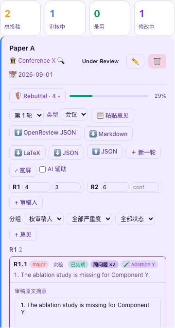
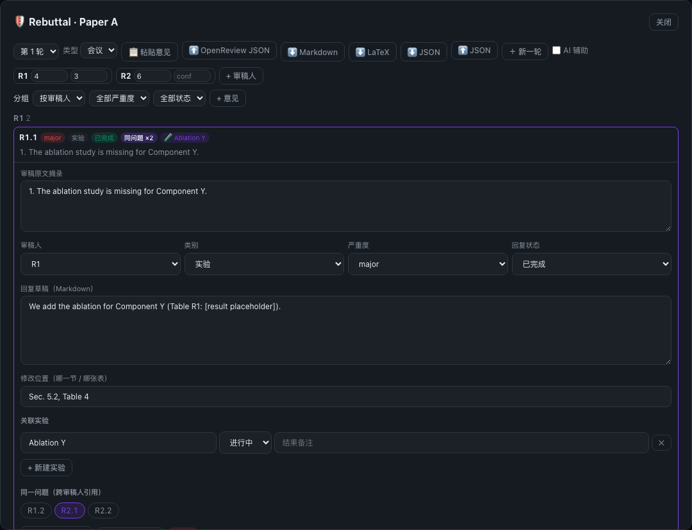
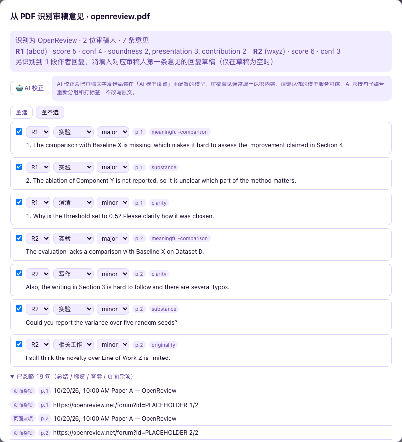

# 🛡 Rebuttal 工作台

把"审稿意见 → 分类 → 关联实验 → 回复状态"整理成一张可编辑的表。会议（OpenReview）和期刊（编辑来信）都适用，所有内容都由你自己填写。

入口：「📖 文献 & 投稿」→「📄 投稿管理」，每张投稿卡片下方的 **🛡 Rebuttal** 按钮和进度条。



## 工作流

1. **导入意见**
   - **📋 粘贴意见**：把整段审稿意见贴进来，点「切条预览」。
     - 按空行和编号（`1.`、`(a)`、`W1`、`Q1`、`Weakness 2` 等）自动切成一条条意见；
     - 遇到 `Reviewer 2`、`R3`、`审稿人1` 这类标题，自动切换到对应审稿人；
     - 识别 `Rating:` 和 `Confidence:` 行，记为该审稿人的分数和置信度；
     - `Summary` 和 `Strengths` 部分不切成意见，而是作为该审稿人的摘要保留。
   - **⬆ OpenReview JSON**：导入论文讨论页的全部记录（`{"notes":[…]}` 或数组，API v1 和 v2 都支持）。
     - 匿名访问 OpenReview API 现在需要通过人机验证，所以请登录后用 `openreview-py` 导出：`client.get_all_notes(forum='<forum id>')`，再保存成 JSON。
     - 映射规则：每条 `Official_Review` 对应一位审稿人。匿名审稿人按出现顺序依次记为 R1、R2…，原始 id 保存在 `source_id`。评分取 `rating` / `confidence` 的前导数字，其余子分数放进 `extra`。`weaknesses` 和 `questions` 分别切条。审稿人的 `Official_Comment` 追加为新的意见。作者已经提交过的 `Rebuttal` 会按 `replyto` 填入对应意见的回复草稿（只在草稿为空时填入）。
   - **📄 PDF**：上传审稿意见的 PDF，在**浏览器本地**识别，文件不上传也不保存，识别完先在预览里核对再导入。支持三类格式：
     - OpenReview 论文页打印成的 PDF；
     - ARR 审稿（Summary Of Weaknesses / Comments Suggestions And Typos …）；
     - 期刊决定信（Reviewer #1 / Referee 2 / Associate Editor …）。

     识别其他格式时用通用规则。详见下文「PDF 识别」。
2. **整理**
   - 点开任意一条即可编辑：审稿原文摘录、所属审稿人、类别、严重度、回复状态、回复草稿（Markdown）、修改位置、关联实验、跨审稿人引用。
   - **✂ 在光标处拆分**：把一条意见从光标位置拆成两条。**⤒ 合并到上一条**：原文、草稿和关联实验都会合并过去。
   - 类别：`experiment` 实验 / `clarification` 澄清 / `writing` 写作 / `related_work` 相关工作 / `misunderstanding` 误解 / `decline` 婉拒。导入时会按关键词预先猜一个类别，请人工确认。
3. **关联实验**
   - 「+ 新建实验」：新建一个轻量实验条目，记录名称、状态（todo / running / done）和结果备注。
   - 本机「实验进展」模块里有项目时，也可以从下拉框里直接选，表格中会实时显示该项目最新的运行状态。
   - 同一个实验关联到多条意见时，在任一处修改状态，其他地方会同步更新。
4. **跨审稿人引用**：多位审稿人问的是同一个问题时，互相勾选即可，系统会自动补全成一组。表格里会显示"同问题 ×N"徽标，排序时这类问题靠前。
5. **视图**：可以按审稿人或按类别分组，并按严重度和回复状态筛选。按审稿人分组时，分数低的审稿人排在前面；组内 major 在前。**⤢ 宽屏** 会在弹窗里打开同一份数据。
6. **进度条**：按严重度加权计算完成度，major 记 2、minor 记 1，回复状态为 done 的算作完成。



## PDF 识别



处理流程：
1. 用 pdf.js 按坐标还原行和段落；
2. 删去页眉页脚、页码和打印页里的多余内容，拼接跨行断开的单词；
3. 判断来源平台；
4. 识别审稿人和各项分数（Rating / Confidence / Soundness / Overall Assessment / Excitement …）；
5. 切条：参照 DISAPERE 数据集的标注体系，只有"请求"和"负面评价"的句子才成为一条意见，总结、夸奖、客套归入「已忽略」；
6. 按 ASAP 的审稿方面打标签，再对应到类别和严重度。

预览里可以对每条意见改审稿人、类别、严重度，或者取消勾选：
- 每条意见标有来源页码（`p.N`），导入后也会保存为 `source_page`，方便回到原文核对；
- 标 ⚠ 的条目是规则拿不准的，请重点核对；
- 「已忽略」里的句子可以一键恢复成一条意见；
- 识别到的作者回复（OpenReview 里 Authors 发的评论）会填入对应审稿人第一条意见的回复草稿（仅在草稿为空时）。

**扫描版 PDF**：几乎提取不到文字时，会提示改用 OCR。点「用 OCR 识别」后才会加载 tesseract.js，首次使用需要下载：英文约 6 MB，中英约 8 MB，之后由浏览器缓存。识别全程在本机进行。

**AI 校正**（只有打开「AI 辅助」时才显示）：把**带编号的句子**发给你自己配置的模型，模型只返回"哪些编号属于同一条意见 + 类别 + 严重度"，工作台再用原句拼出引用原文，不会改写；模型编造的编号会被丢弃。审稿意见通常属于保密内容，请确认你的模型服务可信。

测试样本和检查脚本在 `tests/rebuttal-pdf/`，全部为占位数据。运行方法：先在仓库根目录执行 `python3 -m http.server 8799`，再运行 `node tests/rebuttal-pdf/check.js`；加上 `OCR=1` 会额外测试 OCR 流程。

## 导出

| 格式 | 结构 |
|---|---|
| **Markdown** | `Response to Reviewers` → （有关联问题时）共性问题汇总 → 每位审稿人一节 → 每条意见依次写 **Comment**（引用原文）/ **Response** / **Changes** |
| **LaTeX** | 结构同上，生成一份不依赖任何 `.cls` 文件的 `article` 文档。纯英文内容用 pdfLaTeX 编译；内容里有中文时会自动加上 `xeCJK`，请改用 XeLaTeX |
| **JSON** | 这篇投稿的全部轮次，可以再导入 |

被跨审稿人引用关联起来的问题，会在**每一处都完整写出回复**：某条没写草稿时，会自动复用同组里已写好的回复，不会出现"见上文 / 见 R1"。还没写回复的条目会显示 `[TODO: response]` 占位。

## 多轮返修

点「＋ 新一轮」会开始第 `round + 1` 轮，审稿人名单沿用上一轮。旧的轮次保留下来但变为只读，可以从左上角的轮次下拉框切回去查看和导出。

## AI 辅助（默认关闭）

勾选工具栏里的「AI 辅助」后，每条意见下面会多出「🤖 意图解读」按钮，调用的是你在「个人设置 → AI 模型设置」里配置的模型。

- AI 只输出两部分：**审稿人意图解读** 和 **回复结构建议**。它**不写最终回复**，不编造数字、实验结果或引用，需要证据的地方用 `[result X]` 这样的占位表示。
- 解读结果只显示在当前页面上，不会写进回复草稿。
- 投稿前请核对会议对生成式 AI 的政策（例如 ACL / ARR 要求披露 AI 的使用情况）。

## 数据

- 新增一个存储 key：`phd_rebuttals`，结构为 `{ [submission_id]: { submission_id, rounds: [...] } }`。它已经注册进全量备份和云同步。
- 每一轮的结构如下：

```text
{ submission_id, venue_type: "conference"|"journal", round,
  reviewers: [{ id: "R1", score?, confidence?, source_id?, summary?, strengths?, extra? }],
  comments: [{ id, reviewer_id, quote, category, severity, linked_experiments: [{ id, name, status, result_note, lab_id? }],
               response_draft, response_status, manuscript_change_location, cross_refs: [comment_id] }],
  created }
```

- 投稿记录（`phd_subs`）本身**不做任何修改**，Rebuttal 数据只是通过投稿 id 关联过去。删除投稿时，对应的 Rebuttal 数据会保留下来，不会被连带删除。
- 导入 JSON 会替换这篇投稿当前的 Rebuttal 数据。替换之前，会先自动把现有数据下载成一份 JSON 备份。
- AI 开关的偏好存在 `phd_rbt_prefs`，只保存在本机。
